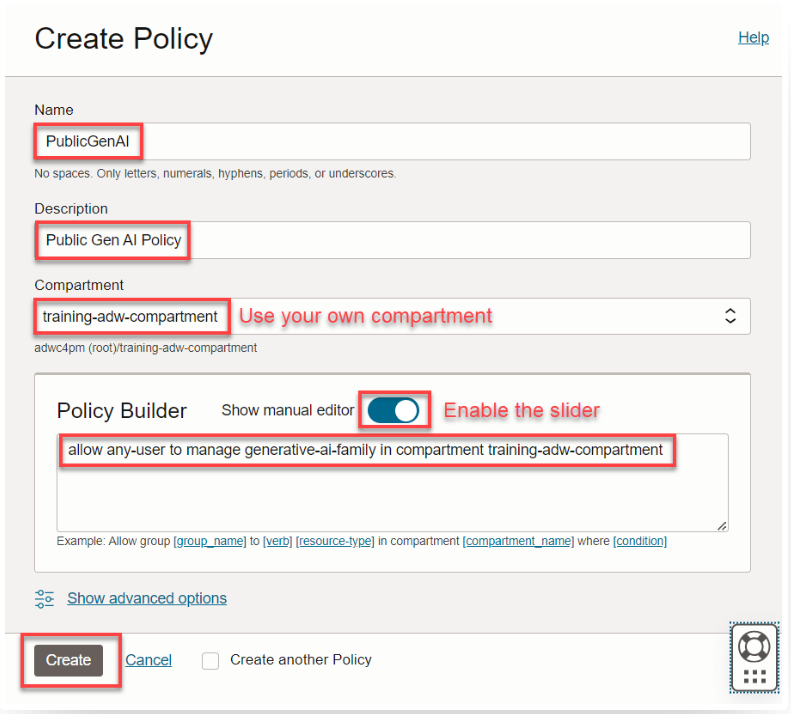

<!--
    {
        "name":"Create Policy to Enable Access to OCI Generative AI",
        "description":"Steps to create a policy"
    }
-->

> **Note:** This task is only required if you are using **OCI Generative AI** as your AI provider.

Create a policy that will enable you to use **OCI Generative AI** within your previously defined compartment. **Make sure your policy uses the compartment where your Autonomous AI Database is deployed**. The policy will be necessary for Autonomous AI Database to interact with OCI Generative AI.

To create an OCI Compartment:

1. From the Console, open the Navigation menu and click Identity & Security. Under Identity, click Policies.

2. Click Create policy and specify the following into the appropriate fields:

>**Note:** Slide the Show manual editor control to display the text field in order to paste the policy.

* **Name:** `OCIGenAI`
* **Description:** `OCIGenAI policy`
* **Compartment:** Select your own compartment
* **Policy Builder:** `allow any-user to manage generative-ai-family in compartment training-adw-compartment`

3. Click **Create**.

 

>**Note:** This policy allows any Autonomous AI Database in the specified compartment to access OCI Generative AI. In a production environment, ensure your policy's scope is minimally inclusive.

This completes the task of creating a policy to enable access to OCI Generative AI.
