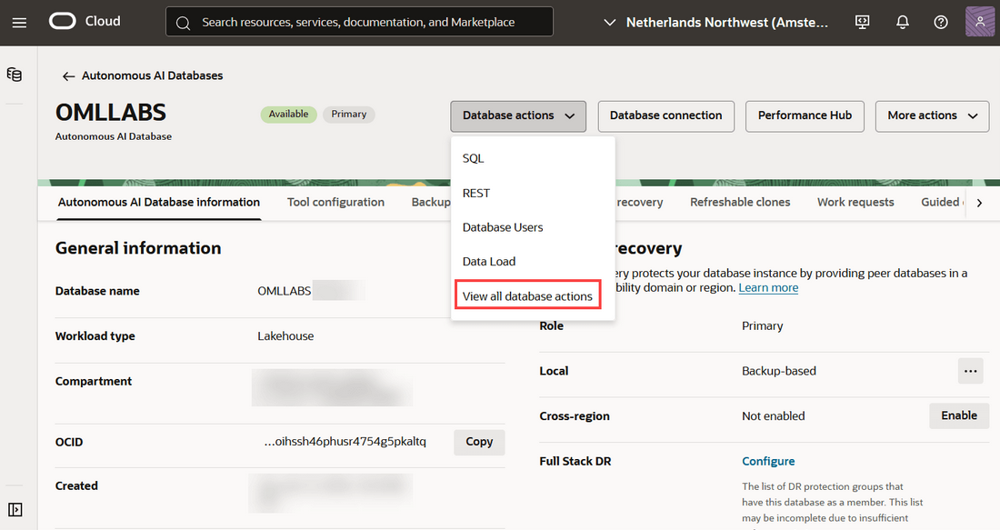
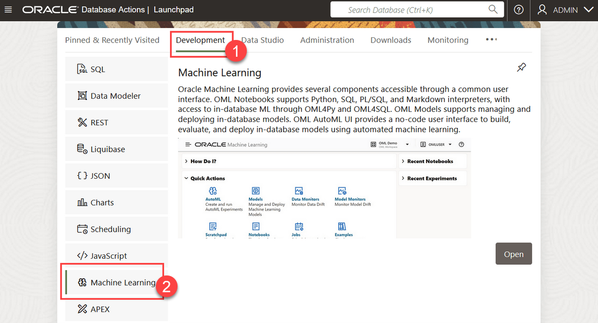
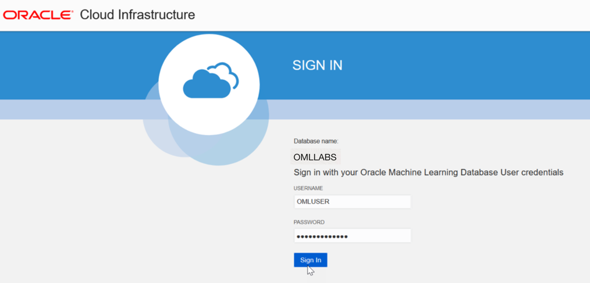
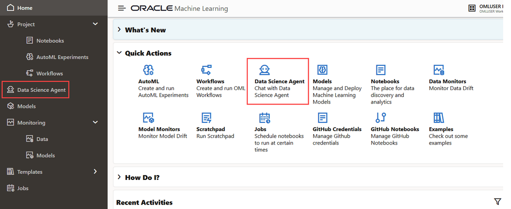
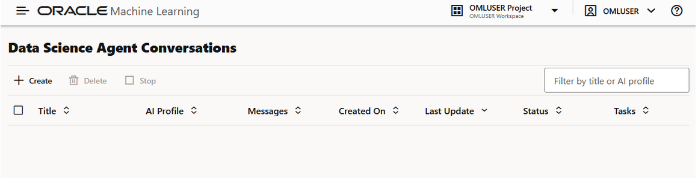

<!--
    {
        "name":"Access Oracle Data Science Agent",
        "description":"Steps to sign into OML Data Science Agent"
    }
-->

You can access Data Science Agent directly from the Oracle Machine Learning UI home page.
To access Data Science Agent, you must first sign into Oracle Machine Learning UI from Autonomous AI Database. To sign into Oracle Machine Learning from an Autonomous AI Database instance:

1. On the Autonomous AI Database information page click **Database actions** and then click **View all database actions**. The Database Actions Launchpad opens.

    

2. On the Database Actions page, go to the **Development** tab and click **Machine Learning**. The Oracle Machine Learning UI sign in page opens.

    

3. On the Oracle Machine Learning UI sign in page, enter your username and password, and click **Sign in**. The Oracle Machine Learning UI home page opens.
    

4. On your Oracle Machine Learning UI home page, under Quick Actions, click **Data Science Agent**.

    Alternatively, you can click the Cloud menu icon  on the top left to open on the left navigation pane. Here, click **Data Science Agent**.

    

5. This opens the Data Science Conversations listing page.

    

